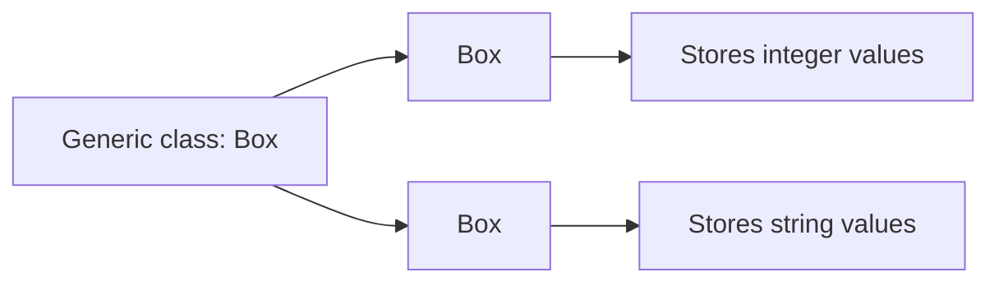
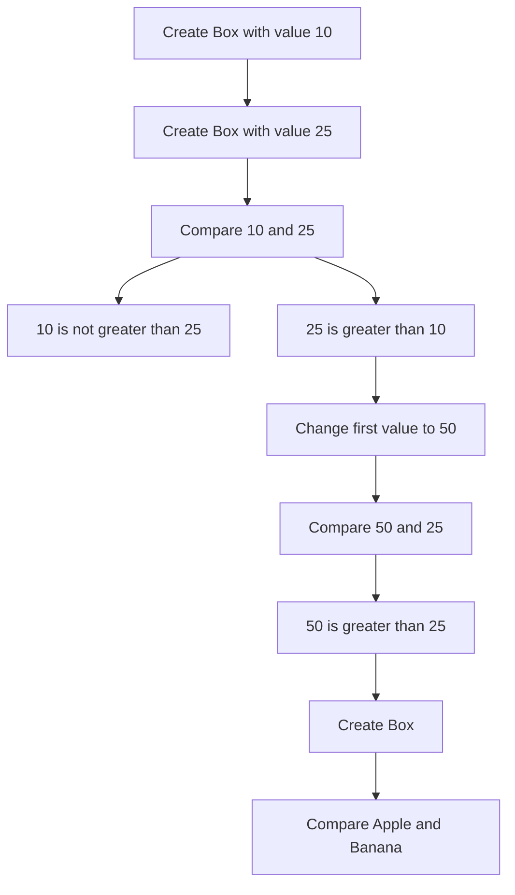
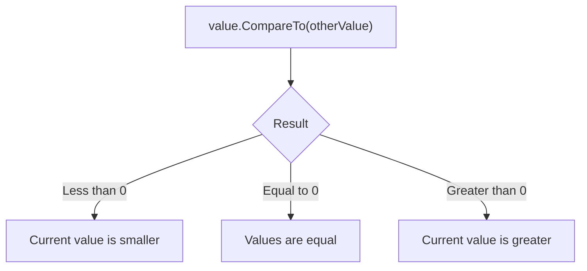

Generic Box Example
This project demonstrates how to use generic classes and generic constraints in C#.
What This Example Shows
- Generic classes
- Type parameters
- Generic constraints
- where T : IComparable<T>
- Type-safe reusable code
- Comparing values with CompareTo
- Using the same class with int and string
- Compile-time type safety
Project Structure
GenericPractice/
├── Box.cs
├── Program.cs
└── GenericPractice.csproj
Generic Class Diagram

Box.cs
using System;

public class Box<T> where T : IComparable<T>
{
    private T _value;

    public Box(T value)
    {
        _value = value;
    }

    public T GetValue()
    {
        return _value;
    }

    public void SetValue(T value)
    {
        _value = value;
    }

    public bool IsGreaterThan(Box<T> other)
    {
        return _value.CompareTo(other._value) > 0;
    }

    public bool IsEqualTo(Box<T> other)
    {
        return _value.CompareTo(other._value) == 0;
    }

    public void PrintType()
    {
        Console.WriteLine(typeof(T));
    }
}
Program.cs
using System;

public static class Program
{
    public static void Main()
    {
        Box<int> first = new(10);
        Box<int> second = new(25);

        Console.WriteLine(first.GetValue());
        Console.WriteLine(second.GetValue());

        Console.WriteLine(first.IsGreaterThan(second));
        Console.WriteLine(second.IsGreaterThan(first));

        Box<int> third = new(10);

        Console.WriteLine(first.IsEqualTo(third));

        first.SetValue(50);

        Console.WriteLine(first.GetValue());
        Console.WriteLine(first.IsGreaterThan(second));

        Box<string> word1 = new("Apple");
        Box<string> word2 = new("Banana");

        Console.WriteLine(word1.IsGreaterThan(word2));
        Console.WriteLine(word2.IsGreaterThan(word1));

        first.PrintType();
        word1.PrintType();
    }
}
How the Program Works

How CompareTo Works

The method CompareTo returns:
- A negative number when the current value is smaller
- 0 when both values are equal
- A positive number when the current value is greater
Example:
10.CompareTo(25); // negative number
25.CompareTo(25); // 0
50.CompareTo(25); // positive number
Generic Constraint
where T : IComparable<T>
This constraint means that type T must implement IComparable<T>.

Because of this restriction, the compiler knows that every valid T has a CompareTo method.
_value.CompareTo(other._value)
Both int and string implement IComparable<T>, so they can be used with Box<T>.
Why Generics Are Useful
Without generics, we could use object:
object value = 10;
This can cause:
- Boxing and unboxing
- Invalid casts
- Runtime exceptions
- Weaker type safety
With generics:
Box<int> numberBox = new(10);
Box<string> textBox = new("Hello");
The compiler knows the exact type and prevents invalid operations during compilation.
Important Terms
- Generic type — a type that works with different data types.
- Type parameter — a placeholder type such as T.
- Generic constraint — a rule that limits which types can be used.
- IComparable<T> — an interface that allows values to be compared.
- Type safety — incorrect types are rejected during compilation.
- CompareTo — compares two values.
- Specialization — creating a concrete type such as Box<int>.
- Compile-time checking — type errors are found before the program runs.
Expected Output
10
25
False
True
True
50
True
False
True
System.Int32
System.String
How to Run
dotnet run
To build the project:
dotnet build
Possible Improvements
- Add IsLessThan
- Add SwapValue
- Override ToString
- Add null validation for other
- Implement IEquatable<Box<T>>
- Create a generic collection class
- Add unit tests
- Add sorting functionality
- Add support for custom comparable classes
Main Idea
Generics allow one class to work with different data types without duplicating code.
Box<int> numberBox = new(10);
Box<string> textBox = new("Hello");
The same Box<T> class works with both int and string, while the constraint guarantees that the stored values can be compared safely.
