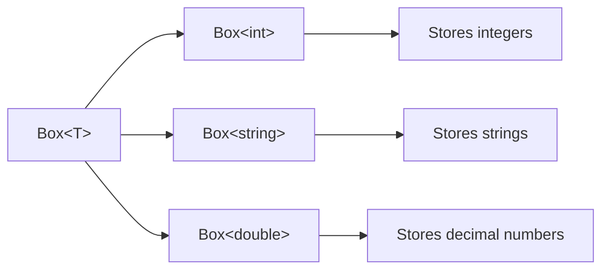
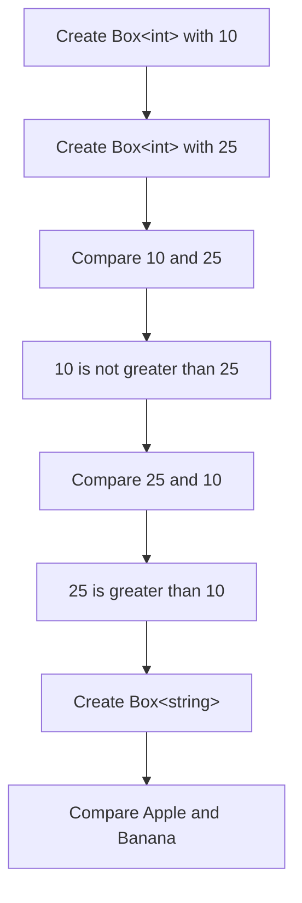
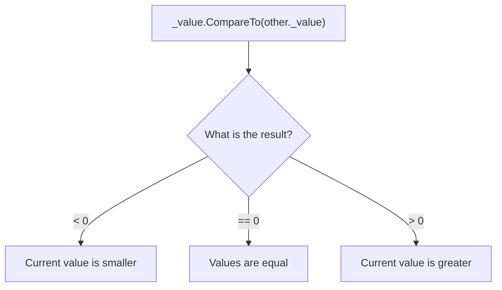

Generic Box Example
Overview
This project demonstrates how to create and use a generic class in C#.

The Box<T> class can store different types of values, such as:
- int
- string
- double
- DateTime
- custom types that implement IComparable<T>
The same class can be reused without duplicating code.
Project Structure
GenericPractice/
│
├── Box.cs
├── Program.cs
├── GenericPractice.csproj
└── README.md
How Generics Work

T is a type parameter. It is replaced with a real type when the class is used.

Example:
Box<int>
Box<string>
The Generic Constraint
where T : IComparable<T>
This constraint means that T must implement IComparable<T>.

The constraint is required because the class uses:
_value.CompareTo(other._value)
The compiler must know that every valid type T contains a CompareTo method.

Both int and string implement IComparable<T>, so they can be used with Box<T>.
Box.cs
using System;

public class Box<T> where T : IComparable<T>
{
    private T _value;

    public Box(T value)
    {
        _value = value;
    }

    public T GetValue()
    {
        return _value;
    }

    public void SetValue(T value)
    {
        _value = value;
    }

    public bool IsGreaterThan(Box<T> other)
    {
        ArgumentNullException.ThrowIfNull(other);

        return _value.CompareTo(other._value) > 0;
    }

    public bool IsEqualTo(Box<T> other)
    {
        ArgumentNullException.ThrowIfNull(other);

        return _value.CompareTo(other._value) == 0;
    }

    public void PrintType()
    {
        Console.WriteLine(typeof(T));
    }
}
Program.cs
using System;

class Program
{
    static void Main()
    {
        Box<int> first = new(10);
        Box<int> second = new(25);

        Console.WriteLine(first.GetValue());
        Console.WriteLine(second.GetValue());

        Console.WriteLine(first.IsGreaterThan(second));
        Console.WriteLine(second.IsGreaterThan(first));

        Box<int> third = new(10);

        Console.WriteLine(first.IsEqualTo(third));

        first.SetValue(50);

        Console.WriteLine(first.GetValue());
        Console.WriteLine(first.IsGreaterThan(second));

        Box<string> word1 = new("Apple");
        Box<string> word2 = new("Banana");

        Console.WriteLine(word1.IsGreaterThan(word2));
        Console.WriteLine(word2.IsGreaterThan(word1));

        word1.PrintType();
        word2.PrintType();
    }
}
Program Flow

Expected Output
10
25
False
True
True
50
True
False
True
System.Int32
System.String
How CompareTo Works
CompareTo returns:
Less than zero  -> the first value is smaller
Zero            -> both values are equal
Greater than zero -> the first value is greater
Example:
int result = 25.CompareTo(10);
The result is greater than zero, so 25 is greater than 10.

For strings, comparison is alphabetical:
"Apple".CompareTo("Banana")
Apple comes before Banana, so the result is less than zero.
Comparison Logic

Why Generics Are Useful
Without generics, we might use object:
object value = 10;
This can cause:
- boxing and unboxing;
- invalid casts;
- runtime errors;
- weaker type safety.
With generics:
Box<int> numberBox = new(10);
Box<string> textBox = new("Hello");
The compiler knows the exact type and can reject invalid operations during compilation.
Example of Type Safety
This code is valid:
Box<int> numberBox = new(10);
This code is also valid:
Box<string> textBox = new("Hello");
But this code is invalid:
Box<int> numberBox = new("Hello");
The compiler rejects it because "Hello" is a string, not an integer.
Important Terms
Generic type
A type that works with different data types.
Box<T>
Type parameter
A placeholder for a real type.
T
Generic constraint
A rule that limits which types can be used.
where T : IComparable<T>
Type safety
The compiler prevents invalid type operations.
IComparable<T>
An interface that allows values to be compared.
CompareTo
A method that returns information about the order of two values.
Specialization
Creating a concrete generic type from a generic type definition.
Box<int>
Box<string>
Connection with Richter's Theory
Generics allow one class to work with many types without duplicating code.

The compiler creates a strongly typed version of the generic class for each used type.

For example:
Box<int>
Box<string>
These are two different constructed generic types based on the same generic class:
Box<T>
The generic constraint tells the compiler which operations are guaranteed to be available for T.

In this example, the constraint guarantees that T supports:
CompareTo
This is an example of compile-time type safety.
Possible Improvements
- Add IsLessThan.
- Add SwapValue.
- Override ToString.
- Implement IEquatable<Box<T>>.
- Add null validation for values.
- Create a generic collection class.
- Add unit tests.
- Add support for custom comparable types.
- Add a Min and Max method.
- Make the class immutable if SetValue is not required.
